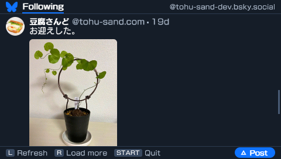

# PSPSky

[日本語](README.md) | [English](README.en.md)

A [Bluesky](https://bsky.app) client for the PSP (PlayStation Portable). It connects directly to `bsky.social` over TLS 1.2 to read the timeline and post. No relay server is required.



## Features

- Read the home timeline: up to 100 posts and four images per post.
- Write text posts of up to 300 characters, with Japanese input support.
- Attach up to four JPEG or PNG images per post, up to 2,000,000 bytes each, with optional ALT text for each image.

Link card contents are not displayed.

## Requirements

| Item | Requirement |
|---|---|
| Console | PSP-1000 / 2000 / 3000 |
| Firmware | Custom firmware such as [ARK-4](https://github.com/PSP-Archive/ARK-4) |
| Memory Stick | At least 2 MB free |
| Wi-Fi | "Connection 1" in the XMB network settings |
| Account | A Bluesky account and app password |

The PSP supports 802.11b only. Enable 802.11b on the access point's 2.4 GHz band. Stock firmware supports encryption up to WPA-PSK (TKIP); WPA2 (AES) requires compatible custom firmware. WPA3-only networks are not supported.

## Installation

Create an app password in Bluesky's settings, then place the files as follows:

```text
ms0:/PSP/GAME/PSPSKY/
├── EBOOT.PBP
├── cacert.pem
└── pspsky.cfg
```

Copy `cacert.pem` from the repository's `assets/cacert.pem`. It is required for TLS certificate verification.

`pspsky.cfg` is created after the first successful login. Enter your handle and app password at startup, or create the configuration file below beforehand.

## Configuration

`ms0:/PSP/GAME/PSPSKY/pspsky.cfg` is a text file with the following format:

```text
identifier=user.bsky.social
password=xxxx-xxxx-xxxx-xxxx
lang=en
images=on
```

| Key | Meaning |
|---|---|
| `identifier` | Your Bluesky handle without `@`. For a custom domain, use the domain itself |
| `password` | Your app password, including hyphens |
| `lang` | `ja` or `en`. Uses the console's language setting if omitted |
| `images` | Fetch avatars and post images: `on` (default) or `off` |

Do not use spaces around `=` or quotes around values. The order of lines does not matter. Delete the file to enter your login details again.

**Your handle and app password are stored in plaintext. Do not use your main account password.** App passwords can be revoked individually in Bluesky's settings.

## Controls

| Button | Action |
|---|---|
| ↑ / ↓, analog stick | Scroll. Hold the D-pad or tilt the stick further to scroll faster |
| L | Refresh the timeline |
| R, or ↓ at the bottom | Load older posts, up to 100 in total |
| △ | Compose a post. On the confirmation screen, remove the last attachment |
| ○ | Confirm |
| □ | Add an image on the post confirmation screen (up to four) |
| × | Cancel. On the image preview screen, choose another file |
| START | Quit |

### Japanese input

| Button | Action |
|---|---|
| SELECT | Switch character set: hiragana, katakana, alphanumeric, or symbols |
| △ | Convert hiragana, or insert a space when the input is empty |
| ↑ / ↓ | Select a conversion candidate |
| ○ | Accept the candidate |
| START | Finish input and proceed to the confirmation screen |

### Attaching images

1. Enter the post text and press □ on the confirmation screen.
2. Select a JPEG or PNG in the file browser.
3. Check the image, file size, and dimensions in the preview, then press ○.
4. Enter optional ALT text (an image description) for that image.
5. Press □ on the confirmation screen to add another image, up to four. Check the attachment count and filenames; press △ to remove the last image if needed.
6. Press ○ to upload the images in the selected order and submit the post.

Pressing × in the file browser returns to confirmation with the text and earlier attachments intact. Pressing × on the confirmation screen cancels the entire post.

The controls may be unresponsive for up to 180 seconds per image during an upload. The screen shows which image is being uploaded. Wait for it to finish before turning off the PSP.

## Building

Install the [pspdev SDK](https://github.com/pspdev/pspdev), the PSP builds of libcurl, mbedTLS, zlib, and intraFont, and GNU make on the host.

Run these commands at the repository root:

```sh
export PSPDEV=/path/to/pspdev
export PATH="$PSPDEV/bin:$PATH"
make
```

Copy the generated `EBOOT.PBP` and `assets/cacert.pem` to the installation directory.

### Updating the CA bundle

With curl and OpenSSL installed, update `assets/cacert.pem` with:

```sh
sh tools/make_cacert.sh
```

Copy the updated file to the folder containing `EBOOT.PBP` on the PSP.

## Troubleshooting

TLS errors include a code in the form `(curl:number)`.

| Symptom | What to check |
|---|---|
| Cannot read `cacert.pem` (curl:77) | Check that the file exists at the displayed path and is not named `cacert.pem.txt` |
| Certificate verification fails (curl:60) | Check the console's date, time, and time zone. If it persists, regenerate and replace the CA bundle |
| TLS handshake fails (curl:35) | Check signal strength, move closer to the router, and retry with L |
| Cannot connect to the access point | Check the WLAN switch, "Connection 1", and the access point's 802.11b and encryption settings |
| Login fails | Remove any `@` from the handle and check the app password, including hyphens |
| "Please wait and retry" | Rate limiting: wait a few minutes, then refresh with L |
| Returns to the XMB immediately | Check that custom firmware is active, then copy `EBOOT.PBP` again |
| Japanese text is missing | Check for the console font `flash0:/font/jpn0.pgf` |
| Images or avatars are missing | Possible causes include `images=off`, failed requests, unsupported formats, and a full cache. Check settings and connectivity, then refresh with L |
| Loading is slow | Set `images=off` to skip image and avatar fetching. Set it back to `images=on` to restore them |

## License

[MIT License](LICENSE). See [THIRD_PARTY_LICENSES.md](THIRD_PARTY_LICENSES.md) for third-party software and bundled assets.
