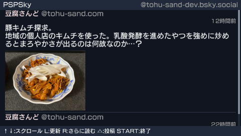

# PSPSky

[日本語](README.md) | [English](README.en.md)

PSP（PlayStation Portable）で動作する [Bluesky](https://bsky.app) クライアントです。`bsky.social` に TLS 1.2 で直接接続し、タイムラインの閲覧と投稿ができます。中継サーバーは不要です。



## 機能

- ホームタイムラインの閲覧（最大 100 件、画像は 1 投稿につき 4 枚まで）。
- 300 文字までのテキスト投稿。日本語入力に対応しています。
- JPEG / PNG の添付（1 投稿につき 1 枚、2,000,000 バイト以下）。ALT テキストも付けられます。

引用投稿やリンクカードの内容表示には対応していません。

## 動作環境

| 項目 | 要件 |
|---|---|
| 本体 | PSP-1000 / 2000 / 3000 |
| ファームウェア | [ARK-4](https://github.com/PSP-Archive/ARK-4) などの CFW |
| メモリースティック | 空き 2 MB 以上 |
| Wi-Fi | XMB のネットワーク設定にある「接続設定1」 |
| アカウント | Bluesky アカウントとアプリパスワード |

PSP の無線 LAN は 802.11b のみです。アクセスポイントで 2.4 GHz 帯の 802.11b を有効にしてください。標準の暗号方式は WPA-PSK（TKIP）までで、WPA2（AES）への接続には対応する CFW が必要です。WPA3 専用のネットワークには接続できません。

## インストール

Bluesky の設定からアプリパスワードを発行し、次のようにファイルを配置してください。

```text
ms0:/PSP/GAME/PSPSKY/
├── EBOOT.PBP
├── cacert.pem
└── pspsky.cfg
```

`cacert.pem` はリポジトリの `assets/cacert.pem` をコピーします。TLS 証明書の検証に必要です。

`pspsky.cfg` は初回ログイン後に自動生成されます。初回起動時にハンドルとアプリパスワードを入力するか、あらかじめ次の設定ファイルを作成してください。

## 設定

`ms0:/PSP/GAME/PSPSKY/pspsky.cfg` は次の形式のテキストファイルです。

```text
identifier=user.bsky.social
password=xxxx-xxxx-xxxx-xxxx
lang=en
images=on
```

| キー | 内容 |
|---|---|
| `identifier` | Bluesky のハンドル。`@` は付けず、カスタムドメインの場合はそのドメインを指定 |
| `password` | アプリパスワード。ハイフンを含めて入力 |
| `lang` | `ja` または `en`。省略時は本体の言語設定に従う |
| `images` | アバターと投稿画像の取得。`on`（既定）または `off` |

`=` の前後にスペースや引用符を入れないでください。行の順序は問いません。ログイン情報を入力し直す場合は、このファイルを削除してください。

**ハンドルとアプリパスワードは平文で保存されます。アカウント本体のパスワードは使用しないでください。** アプリパスワードは Bluesky の設定から個別に失効させられます。

## 操作

| ボタン | 動作 |
|---|---|
| ↑ / ↓、アナログスティック | スクロール。十字キーの長押しやスティックの傾きで速度を調節 |
| L | タイムラインを更新 |
| R、または最下部で ↓ | 過去の投稿を読み込む（累計 100 件まで） |
| △ | 投稿を作成 |
| ○ | 決定 |
| □ | 投稿確認画面で画像を添付 |
| × | キャンセル。画像プレビュー画面ではファイルを選び直す |
| START | 終了 |

### 日本語入力

| ボタン | 動作 |
|---|---|
| SELECT | 文字種を切り替える（ひらがな / カタカナ / 英数 / 記号） |
| △ | ひらがなを変換。未入力時は空白を挿入 |
| ↑ / ↓ | 変換候補を選ぶ |
| ○ | 変換候補を確定 |
| START | 入力を終えて確認画面へ進む |

### 画像を添付する

1. 本文を入力し、投稿確認画面で □ を押します。
2. ファイルブラウザで JPEG / PNG を選びます。
3. プレビューで画像、ファイルサイズ、寸法を確認し、○ を押します。
4. 必要に応じて ALT テキスト（画像の説明）を入力して投稿します。

アップロード中は最大 180 秒、操作できなくなることがあります。完了するまで電源を切らずに待ってください。

## ビルド

[pspdev SDK](https://github.com/pspdev/pspdev) と、PSP 向けの libcurl、mbedTLS、zlib、intraFont が必要です。ホスト側には GNU make を用意してください。

リポジトリのルートで実行します。

```sh
export PSPDEV=/path/to/pspdev
export PATH="$PSPDEV/bin:$PATH"
make
```

生成された `EBOOT.PBP` と `assets/cacert.pem` をインストール先へコピーしてください。

### CA バンドルの更新

curl と OpenSSL を用意し、次のコマンドで `assets/cacert.pem` を更新します。

```sh
sh tools/make_cacert.sh
```

更新したファイルを PSP の `EBOOT.PBP` と同じフォルダへコピーしてください。

## トラブルシューティング

TLS エラーには `(curl:数字)` の形式でエラーコードが表示されます。

| 症状 | 確認すること |
|---|---|
| `cacert.pem` を読み込めない（curl:77） | 表示されたパスにファイルがあるか。ファイル名が `cacert.pem.txt` になっていないか |
| 証明書の検証に失敗する（curl:60） | 本体の日時とタイムゾーン。改善しなければ CA バンドルを再生成して差し替える |
| TLS ハンドシェイクに失敗する（curl:35） | 電波状態を確認し、ルーターに近づいて L で再試行 |
| アクセスポイントに接続できない | WLAN スイッチ、「接続設定1」、アクセスポイントの 802.11b と暗号方式の設定 |
| ログインに失敗する | ハンドルに `@` が入っていないか。アプリパスワードがハイフンを含めて正しいか |
| 「しばらく待ってから再試行してください」 | レート制限のため、数分待ってから L で更新 |
| 起動直後に XMB に戻る | CFW が有効か確認し、`EBOOT.PBP` をコピーし直す |
| 日本語が表示されない | 本体フォント `flash0:/font/jpn0.pgf` があるか |
| 画像やアバターが表示されない | `images=off`、通信失敗、未対応形式、キャッシュ上限が原因の場合がある。設定と接続を確認して L で更新 |
| 読み込みが遅い | `images=off` で画像とアバターの取得を無効にする。戻す場合は `images=on` に変更 |

## ライセンス

[MIT License](LICENSE)。第三者ソフトウェアと同梱素材のライセンスは [THIRD_PARTY_LICENSES.md](THIRD_PARTY_LICENSES.md) を参照してください。
